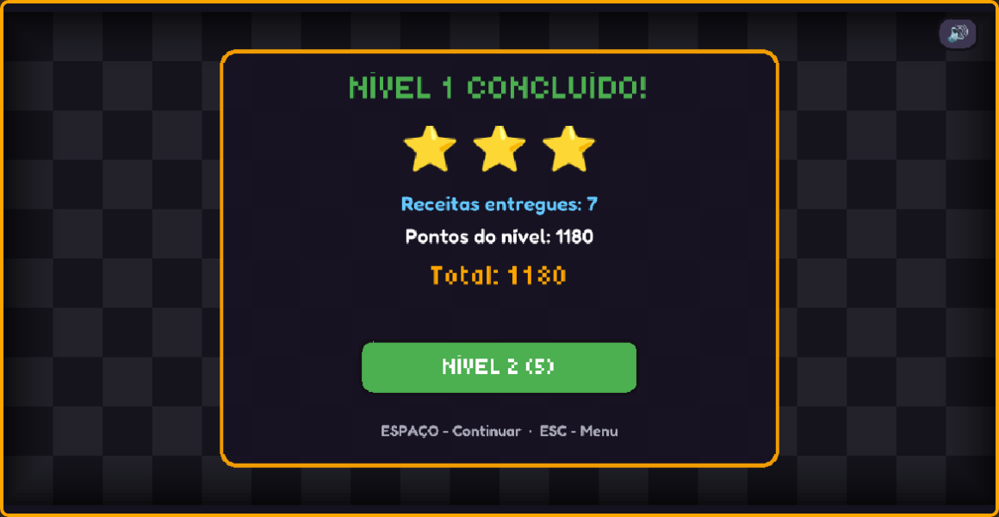
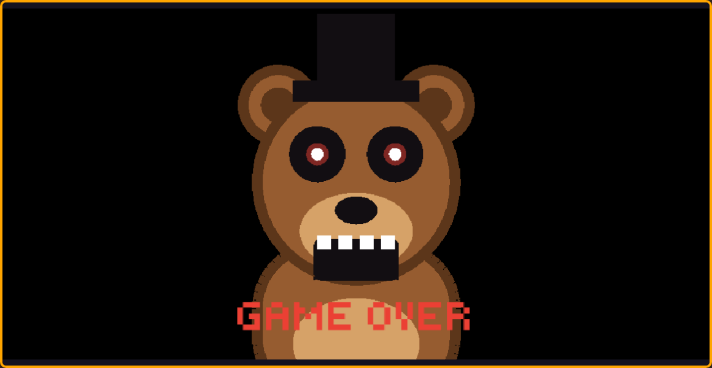

<div align="center">




[](https://fnaf-pizza.vercel.app)
[](https://kaplayjs.com)
[](https://vite.dev)
[](https://fnaf-pizza.vercel.app)

`> INSERT COIN TO CONTINUE_`

</div>

---

## ▶ HOW TO PLAY

Orders show up on the right. Build each pizza at the stations, bake it, and deliver it before the order's timer runs out.

```text
  🫓 DOUGH  →  🍅 SAUCE  →  🧀 🥓 🍄 TOPPINGS  →  🔥 OVEN  →  🍽️ DELIVERY
```

- Always start with **dough**, then add the ingredients the order asks for.
- The oven takes 5 seconds. Pick the pizza up quickly, because **it burns** if you leave it in too long. Burnt pizzas go in the 🗑️ trash.
- Deliver orders back to back to build a **combo** for bonus points.

## ★ STARS

Every level lasts until the clock hits zero, so the more pizzas you deliver, the better you score.

<table align="center">
  <tr>
    <td align="center" width="140">⭐<br><b>2 recipes</b></td>
    <td align="center" width="140">⭐⭐<br><b>4 recipes</b></td>
    <td align="center" width="140">⭐⭐⭐<br><b>6+ recipes</b></td>
  </tr>
</table>

You need at least **one star** to reach the next level. Finish a shift with zero stars and Freddy comes to say hi.

<div align="center">


</div>

## 🕹 CONTROLS

<table align="center">
  <tr>
    <th></th>
    <th>⌨️ Keyboard</th>
    <th>📱 Mobile</th>
  </tr>
  <tr>
    <td><b>Move</b></td>
    <td><kbd>W</kbd> <kbd>A</kbd> <kbd>S</kbd> <kbd>D</kbd> or arrows</td>
    <td>Joystick</td>
  </tr>
  <tr>
    <td><b>Use station</b></td>
    <td><kbd>Space</kbd></td>
    <td>⚡ button</td>
  </tr>
  <tr>
    <td><b>Pause</b></td>
    <td><kbd>Esc</kbd> or <kbd>P</kbd></td>
    <td>⏸️ button</td>
  </tr>
  <tr>
    <td><b>Mute</b></td>
    <td><kbd>M</kbd></td>
    <td>🔊 button</td>
  </tr>
</table>

On phones, play in landscape. The game pauses itself if you rotate to portrait or switch tabs.

## 🍕 RECIPES

<table align="center">
  <tr>
    <th>Margherita</th>
    <th>Queijo Duplo</th>
    <th>Bacon</th>
    <th>Cogumelo</th>
    <th>Supreme</th>
  </tr>
  <tr>
    <td align="center">🫓🍅🧀</td>
    <td align="center">🫓🍅🧀🧀</td>
    <td align="center">🫓🍅🧀🥓</td>
    <td align="center">🫓🍅🧀🍄</td>
    <td align="center">🫓🍅🧀🥓🍄</td>
  </tr>
  <tr>
    <td align="center"><b>100</b> pts</td>
    <td align="center"><b>140</b> pts</td>
    <td align="center"><b>150</b> pts</td>
    <td align="center"><b>150</b> pts</td>
    <td align="center"><b>200</b> pts</td>
  </tr>
</table>

There are 3 levels. Each one has a shorter shift, tighter order timers and more orders at once.

## 💾 RUN LOCALLY

Requires [Node.js](https://nodejs.org) 20+.

```bash
git clone https://github.com/mcemy/fnaf-inspired-overcooked-game.git
cd fnaf-inspired-overcooked-game
npm install
npm run dev
```

Then open the URL Vite prints (usually `http://localhost:5173`). Other scripts:

- `npm run build` builds the production version into `dist/`
- `npm run preview` serves that build locally

> Opening `index.html` directly in the browser won't work. The game imports Kaplay from `node_modules`, so it needs Vite to run.

## 🔧 TECH STACK

- **[Kaplay](https://kaplayjs.com)**: game engine (scenes, input, drawing, audio)
- **JavaScript**: all of the game logic lives in `main.js`
- **[Tiny5](https://fonts.google.com/specimen/Tiny5)** and **[Fredoka](https://fonts.google.com/specimen/Fredoka)**: pixel font for titles, rounded font for small text
- **[Vite](https://vite.dev)**: dev server and build
- **[Vercel](https://vercel.com)**: hosting

All of the art, including Freddy, is drawn in code with Kaplay shapes, so there are no sprite files.

## 📜 LICENSE

This is a fan project made for learning and indie game development practice.
It is not affiliated with *Overcooked* or *Five Nights at Freddy's*.

<div align="center">

`GAME OVER? ▶ CONTINUE`

</div>
