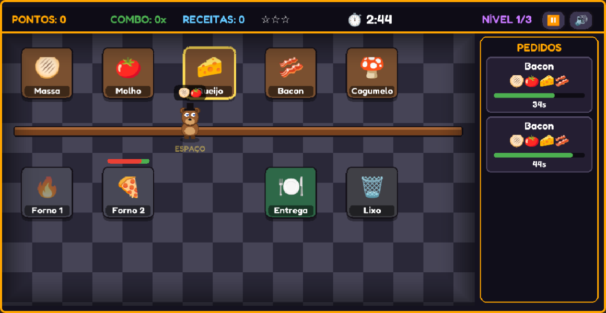

<div align="center">

```text
█████ █   █  ███  █████     ████  █████ █████ █████  ███
█     ██  █ █   █ █         █   █   █      █     █  █   █
████  █ █ █ █████ ████      ████    █     █     █   █████
█     █  ██ █   █ █         █       █    █     █    █   █
█     █   █ █   █ █         █     █████ █████ █████ █   █

         █   █ █████ █████  ████ █   █ █████ █   █
         █  █    █     █   █     █   █ █     ██  █
         ███     █     █   █     █████ ████  █ █ █
         █  █    █     █   █     █   █ █     █  ██
         █   █ █████   █    ████ █   █ █████ █   █
```

**An Overcooked-style cooking game set in Freddy Fazbear's Pizza.**
Cook fast, earn stars, and don't let Freddy down... 🐻

[](https://fnaf-pizza.vercel.app)
[](https://kaplayjs.com)
[](https://vite.dev)
[](https://fnaf-pizza.vercel.app)



`> INSERT COIN TO CONTINUE_`

</div>

---

## ▶ HOW TO PLAY

Orders show up on the right. Build each pizza at the stations, bake it, and deliver it before the order's timer runs out.

```text
  🫓 DOUGH  →  🍅 SAUCE  →  🧀 🥓 🍄 TOPPINGS  →  🔥 OVEN  →  🍽️ DELIVERY
```

- Always start with **dough**, then add the ingredients the order asks for.
- The oven takes 5 seconds. Pick the pizza up quickly, because **it burns** if you leave it in too long. Burnt pizzas go in the 🗑️ trash.
- Deliver orders back to back to build a **combo** for bonus points.

## ★ STARS

Every level lasts until the clock hits zero, so the more pizzas you deliver, the better you score.

| Recipes delivered | Rating |
| :---: | :---: |
| 2 | ⭐☆☆ |
| 4 | ⭐⭐☆ |
| 6+ | ⭐⭐⭐ |

You need at least **one star** to reach the next level. Finish a shift with zero stars and Freddy comes to say hi.

<div align="center">


</div>

## 🕹 CONTROLS

| Action | Keyboard | Mobile |
| --- | --- | --- |
| Move | `WASD` / arrow keys | Joystick |
| Use station | `SPACE` | ⚡ button |
| Pause | `ESC` / `P` | ⏸️ button |
| Mute | `M` | 🔊 button |

On phones, play in landscape. The game pauses itself if you rotate to portrait or switch tabs.

## 🍕 RECIPES

| Pizza | Ingredients | Points |
| --- | --- | :---: |
| Margherita | 🫓 🍅 🧀 | 100 |
| Queijo Duplo | 🫓 🍅 🧀 🧀 | 140 |
| Bacon | 🫓 🍅 🧀 🥓 | 150 |
| Cogumelo | 🫓 🍅 🧀 🍄 | 150 |
| Supreme | 🫓 🍅 🧀 🥓 🍄 | 200 |

There are 3 levels. Each one has a shorter shift, tighter order timers and more orders at once.

## 💾 RUN LOCALLY

Requires [Node.js](https://nodejs.org) 20+.

```bash
git clone https://github.com/mcemy/fnaf-inspired-overcooked-game.git
cd fnaf-inspired-overcooked-game
npm install
npm run dev
```

Then open the URL Vite prints (usually `http://localhost:5173`). `npm start` does the same thing.

> Opening `index.html` directly in the browser won't work. The game imports Kaplay from `node_modules`, so it needs Vite to run.

| Command | What it does |
| --- | --- |
| `npm run dev` | Starts the dev server with hot reload |
| `npm run build` | Builds the production version into `dist/` |
| `npm run preview` | Serves the production build locally |

## 🔧 TECH STACK

| Tech | Used for |
| --- | --- |
| [Kaplay](https://kaplayjs.com) | Game engine: scenes, input, drawing, audio |
| JavaScript | All the game logic (`main.js`) |
| [Tiny5](https://fonts.google.com/specimen/Tiny5) + [Fredoka](https://fonts.google.com/specimen/Fredoka) | Pixel font for titles, rounded font for small text |
| Vite | Dev server and build |
| Vercel | Hosting |

All of the art, including Freddy, is drawn in code with Kaplay shapes, so there are no sprite files.

## 📜 LICENSE

This is a fan project made for learning and indie game development practice.
It is not affiliated with *Overcooked* or *Five Nights at Freddy's*.

<div align="center">

`GAME OVER? ▶ CONTINUE`

</div>
